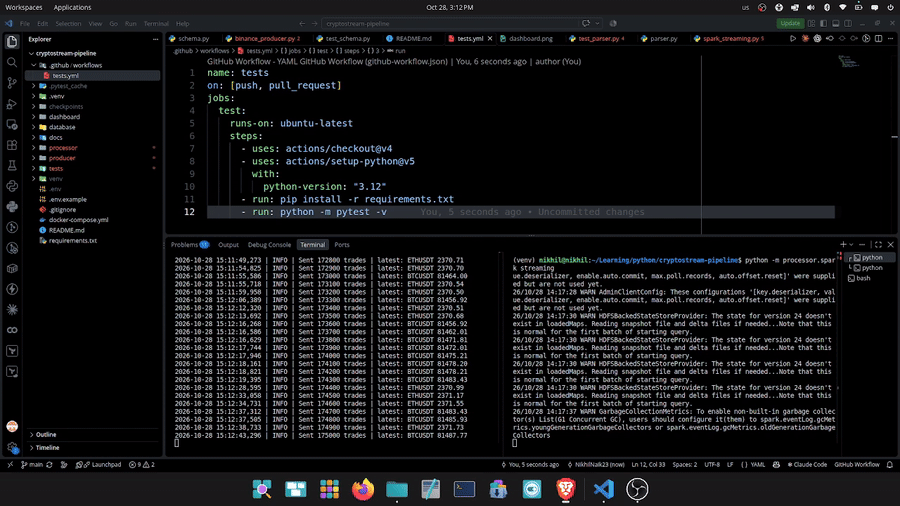
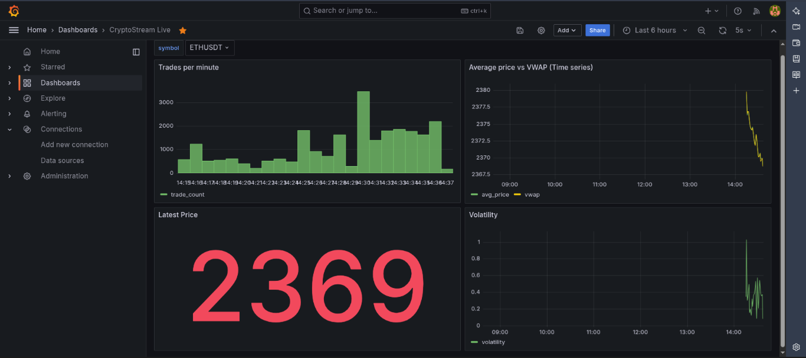
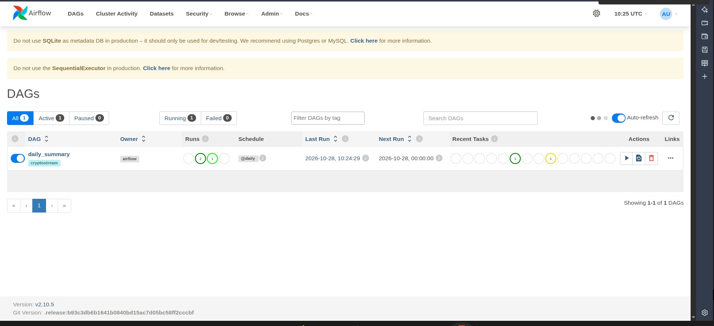
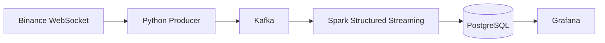

# CryptoStream: Real-Time Crypto Data Pipeline

A streaming data pipeline that ingests live crypto trades, computes rolling
metrics in real time, and visualizes them on an auto-refreshing dashboard.






## Architecture



## Tech stack

| Layer | Tool | Why |
|---|---|---|
| Ingestion | Python + WebSocket | Free, real-time exchange feed; no polling or rate limits |
| Buffer | Apache Kafka | Decouples producer from processing; replay and fault tolerance |
| Processing | Spark Structured Streaming | Windowed aggregations, watermarks, checkpointed recovery |
| Storage | PostgreSQL | Simple local analytics store (BigQuery is a planned swap) |
| Dashboard | Grafana | Auto-refresh every 5s |
| Infra | Docker Compose | One command to start everything |

## Design decisions

- **Kafka over RabbitMQ:** Kafka is a replayable log; RabbitMQ deletes messages once consumed.
- **Spark over Flink:** Micro-batches (5s) are plenty for a dashboard, and PySpark has a larger ecosystem. Flink wins for sub-second latency.
- **Idempotent writes:** `ON CONFLICT` upserts mean retries never create duplicates.
- **Watermark (10s):** tolerates late-arriving trades while bounding Spark's memory.

## Metrics calculated (1-minute windows per coin)

Average price, VWAP, min/max, volatility (std dev), trade count, total volume.

**Price-spike alerts:** a third streaming query compares the first and last
price in each 30-second window and records an alert when the move exceeds a
configurable threshold (`ALERT_THRESHOLD_PCT`).

## Run it

Requirements: Docker, Python 3.12, Java 17.

```bash
git clone https://github.com/NikhilNaik23/cryptostream-pipeline.git
cd cryptostream-pipeline
cp .env.example .env

python3 -m venv venv && source venv/bin/activate
pip install -r requirements.txt

docker compose up -d
docker exec kafka /opt/kafka/bin/kafka-topics.sh --create --topic crypto_trades \
  --bootstrap-server localhost:9092 --partitions 3 --replication-factor 1

python -m producer.binance_producer     # terminal 1
python -m processor.spark_streaming     # terminal 2
```

Open Grafana at http://localhost:3000 and import
`dashboard/grafana/dashboards/<your-file>.json`.

Note: the producer uses `data-stream.binance.vision`, which works in regions
where the main Binance endpoint is blocked.

## Tests

```bash
python -m pytest -v
```

## Future improvements

- Load results into BigQuery and use Looker Studio
- Add Redis for a "latest price" cache
- CI with GitHub Actions